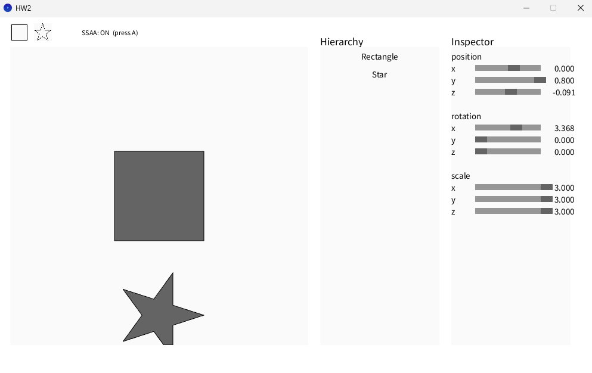
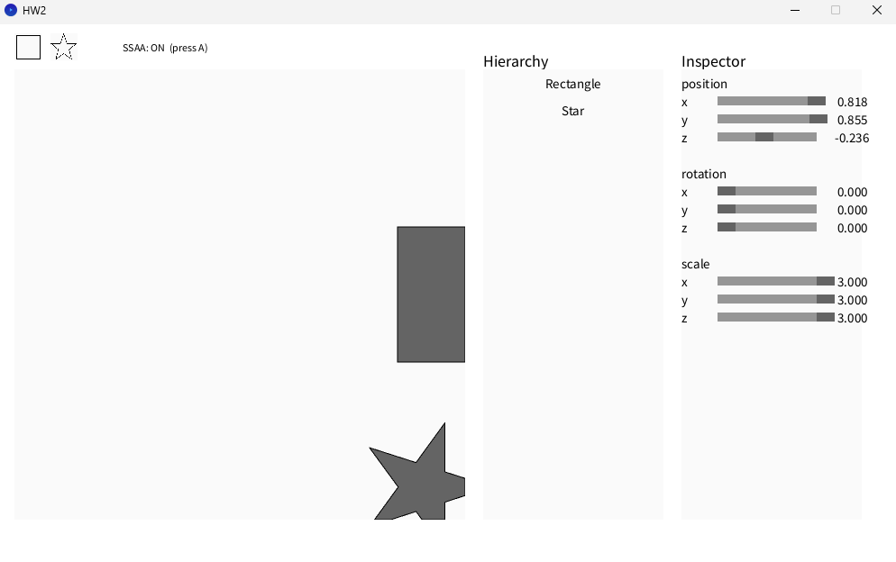
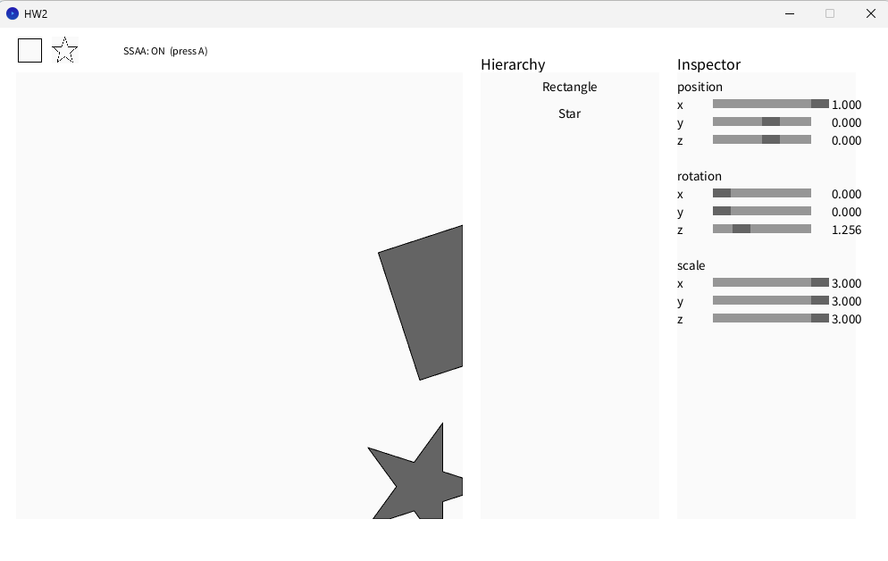
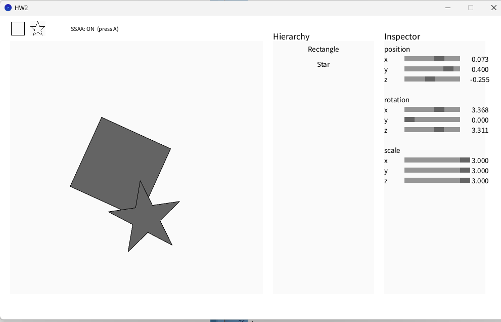
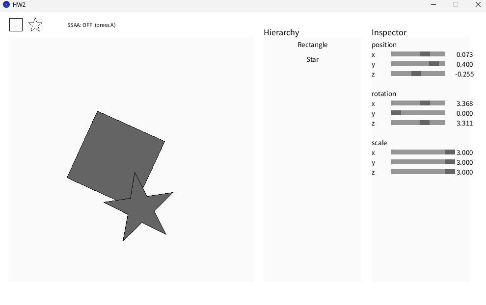
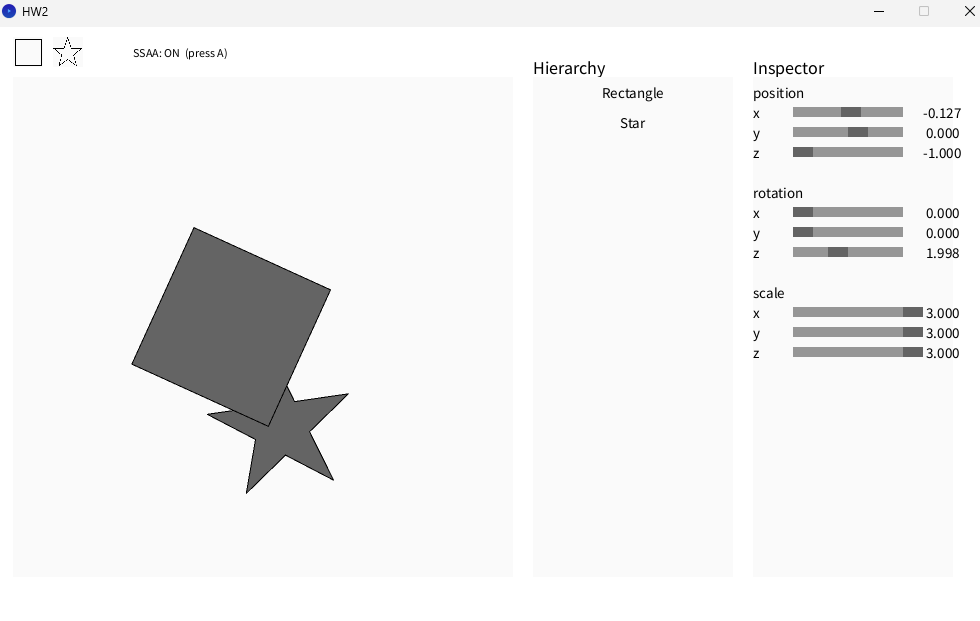
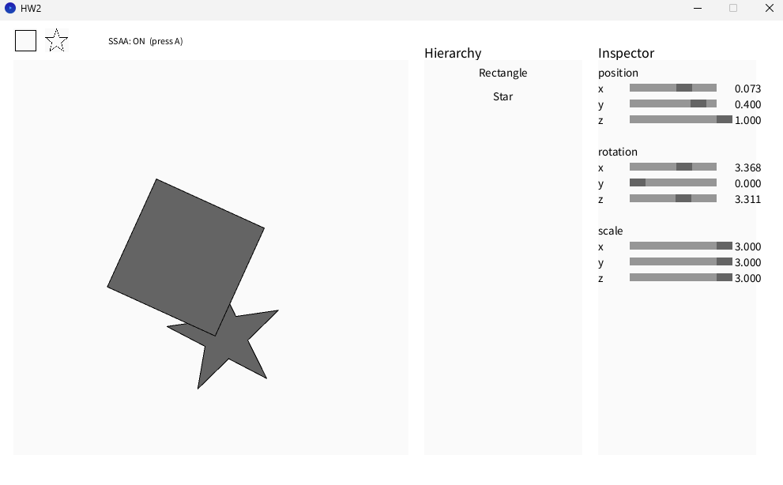

# Computer Graphics Lab 2

## 1. Assignment Overview

This lab builds on Lab 1 using the provided Processing framework. The main tasks are to implement 2D translation, rotation, scaling, polygon filling, bounding-box calculation, and Sutherland–Hodgman polygon clipping. I also implemented 2×2 SSAA as the BONUS feature.

### Implemented Features

- Translation Matrix: Translation (`makeTrans()`)
- Rotation Matrix: Z-axis rotation (`makeRotZ()`)
- Scaling Matrix: Scaling (`makeScale()`)
- pnpoly: Point-in-polygon test using the Odd-Parity Rule
- findBoundBox: Polygon bounding-box calculation
- Sutherland–Hodgman: Clipping polygons to the canvas boundaries
- BONUS — 2×2 SSAA: Super-sampling anti-aliasing with per-sample depth testing

I also reused `CGLine()` from Lab 1 to draw polygon outlines.

## 2. Implementation

### 1. Translation Matrix

I start with an identity matrix using `makeIdentity()`, then place the translation values `t.x`, `t.y`, and `t.z` in `m[3]`, `m[7]`, and `m[11]`. With homogeneous coordinates, translation can be performed through matrix multiplication.

### 2. Rotation Matrix — Z-axis Rotation

I use `cos(a)` and `sin(a)` to construct the Z-axis rotation matrix by setting `m[0]`, `m[1]`, `m[4]`, and `m[5]`, with `m[1] = -sin(a)`. Since this lab focuses on 2D shapes, only Z-axis rotation is required. Angles are calculated in radians.

### 3. Scaling Matrix

After creating an identity matrix, I set the diagonal elements `m[0]`, `m[5]`, and `m[10]` to `s.x`, `s.y`, and `s.z`. Each coordinate axis is then scaled by its corresponding factor. The matrices are combined as `T × R × S`, so scaling is applied first, followed by rotation and translation.

### 4. pnpoly — Odd-Parity Rule

For each pixel being checked, I cast a horizontal ray to the right and test it against every polygon edge. The condition `(yi > y) != (yj > y)` determines whether an edge crosses the ray's Y level. I then calculate the intersection X coordinate, `crossX`. If the intersection lies to the right of the test point, I increase `count` by one.

After checking every edge, I use `count % 2` to determine whether the number of intersections is odd or even. An odd count means the point is inside the polygon and should be filled; an even count means it is outside.

### 5. findBoundBox — Bounding Box

I use the first vertex to initialize the minimum and maximum X and Y values, then compare the remaining vertices with a `for` loop using `min()` and `max()`. The function returns the two opposite corners of the bounding box. This limits polygon filling to the relevant area instead of scanning the entire canvas.

### 6. Sutherland–Hodgman — Polygon Clipping

I clip the polygon against the four canvas boundaries one at a time. For each polygon edge, I use the cross product to determine whether the start point S and end point P lie inside the current clipping boundary. Depending on the four Inside/Outside cases, I keep the endpoint, add an intersection, or add neither.

When a line segment crosses the clipping boundary, I calculate `t = dS / (dS - dP)` and then use `I = S + t(P - S)` to obtain the intersection. After each pass, `output` becomes the `input` for the next pass. The function returns the clipped polygon vertices.

## 3. BONUS — 2×2 SSAA

For this BONUS, I implemented 2×2 Super-Sampling Anti-Aliasing (SSAA) to reduce jagged edges on rendered shapes.

Instead of checking only one location per pixel, I use four sub-sample positions: `(0.25, 0.25)`, `(0.75, 0.25)`, `(0.25, 0.75)`, and `(0.75, 0.75)`. Each sample uses `pnpoly()` to check polygon coverage and stores its own color and depth value. The final pixel color is calculated by averaging the RGB values of all four samples.

I added `SupersampleBuffer.pde` to manage the samples and modified `ShapeRenderer.pde` and `Shape.pde` so that multiple shapes share the same buffer. The buffer is initialized before rendering, and depth testing determines which shape's color is kept at each sample. I also added the `A` key to toggle SSAA ON/OFF, making it easier to compare the edges, and tested overlapping Rectangle and Star shapes with different Z values.

## 4. Implementation Process and AI Assistance

I first referred to the professor's class notes and the provided Processing framework to understand the algorithms required for each function, and tried implementing them myself. When I was unsure about something, I asked ChatGPT to check whether the code was correct and suggest adjustments. I also referred to AI-provided code examples for some features.

For the BONUS, I relied more on the SSAA code structure provided by ChatGPT and integrated it into the original project. I then compared SSAA ON/OFF by running the program and changed the shapes' Z values to observe how overlapping shapes were displayed.

I also used ChatGPT to help organize this README.

## 5. Results

### 1. Basic Shapes and Transformations

I used the Inspector to adjust the position, rotation, and scale of Rectangle and Star shapes and checked that polygon filling worked.

### 2. Sutherland–Hodgman — Polygon Clipping

I moved Rectangle and Star shapes toward the canvas boundaries to check that the portions outside the canvas were clipped while the visible regions remained filled. The second screenshot also shows a rotated Rectangle being clipped by the right canvas boundary.

### 3. BONUS — SSAA ON

With SSAA enabled, the rotated Rectangle and Star are rendered using 2×2 sampling to smooth their diagonal edges.

### 4. BONUS — SSAA OFF

With the same shape settings, I disabled SSAA to compare the results. The diagonal edges appear more jagged than with SSAA enabled.

### 5. BONUS — Depth Test

I overlapped Rectangle and Star shapes and changed their Z values to observe the rendering of the overlapping region.

## 6. References

- Class notes: Transformation Matrix, Odd-Parity Rule, and Sutherland–Hodgman Algorithm
- [CG Lab 2 Assignment](https://hackmd.io/@lab31718/CGlab2)
