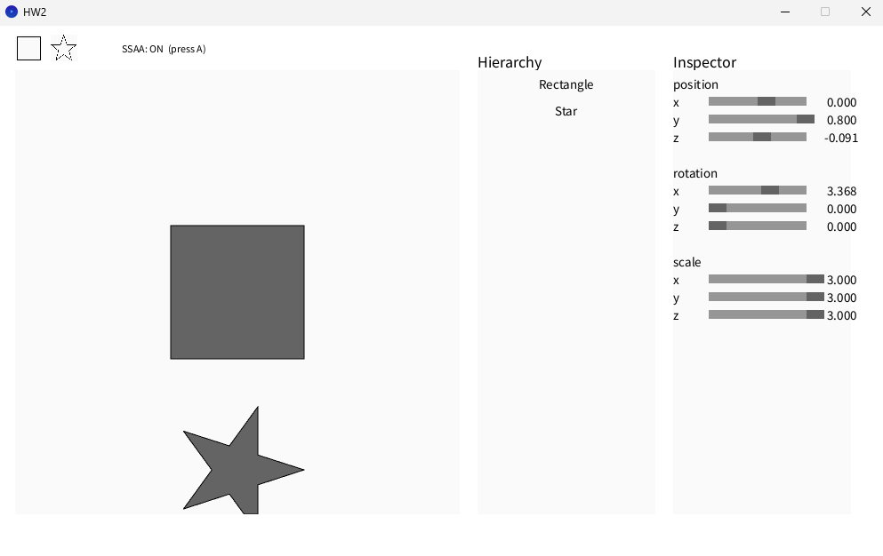
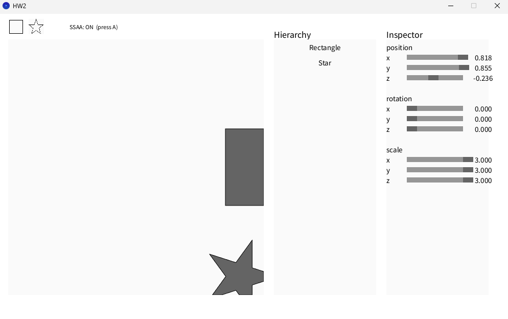
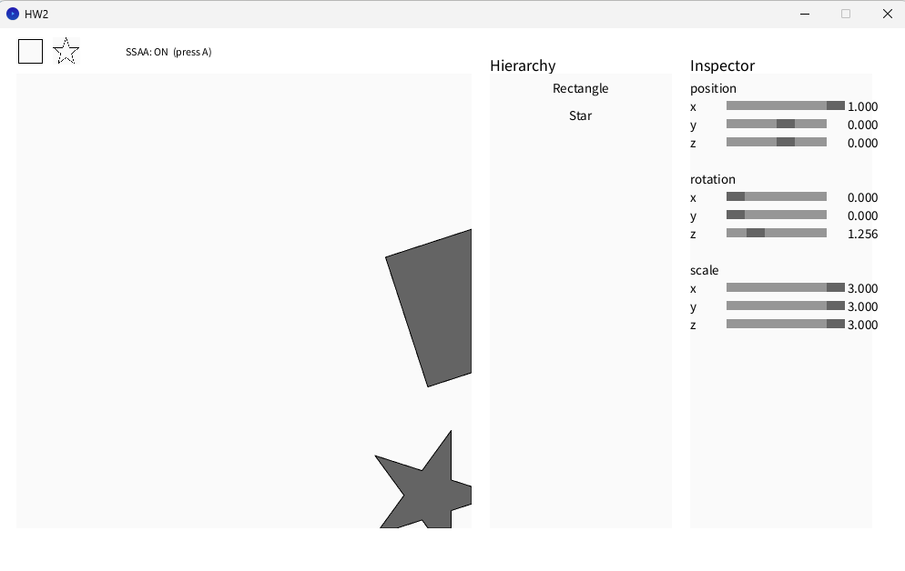
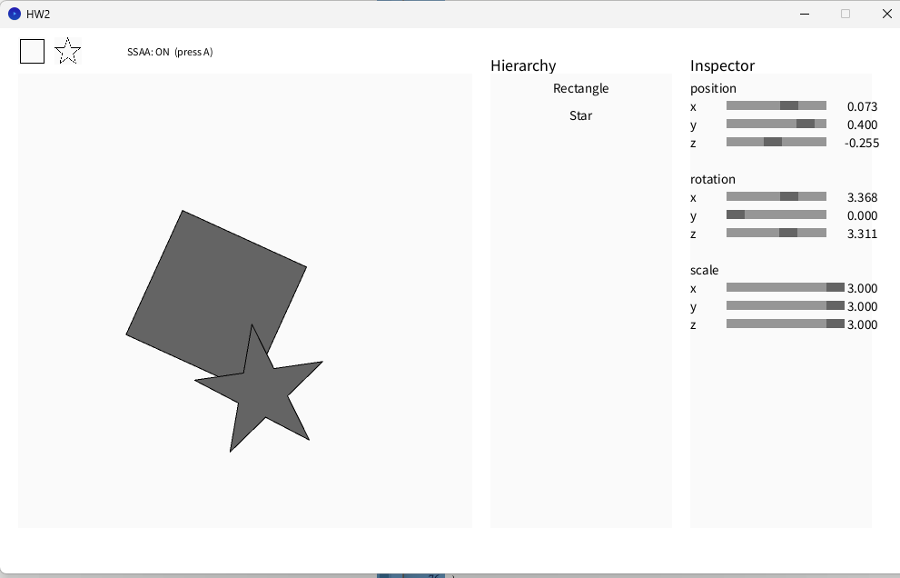
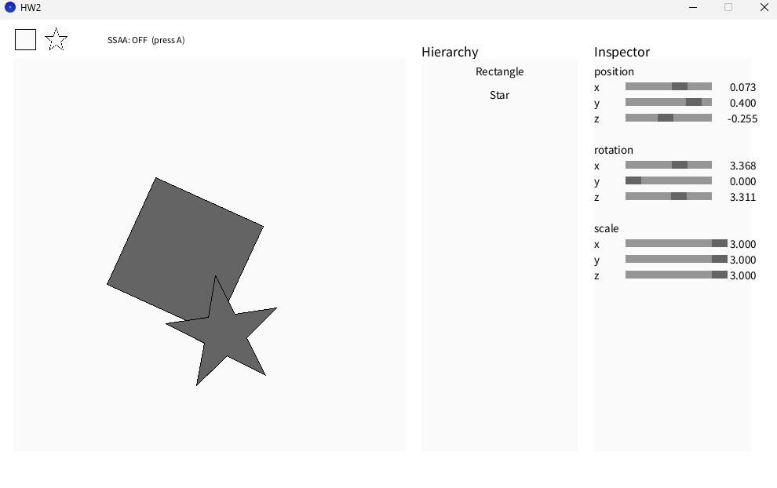
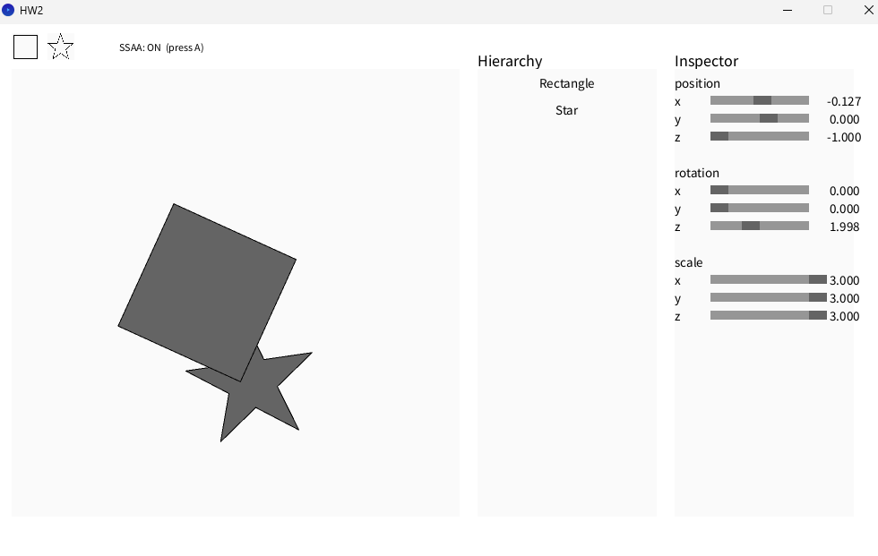
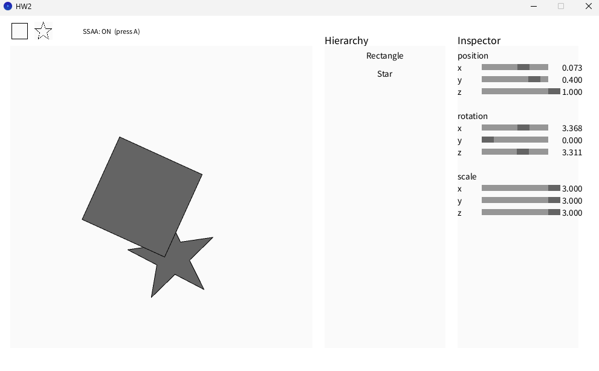

# Computer Graphics Lab 2

## 一、作業內容

這次作業延續 Lab1，利用 Processing 提供的程式架構，實作 2D 圖形的平移、旋轉、縮放、多邊形填色、Bounding Box，以及 Sutherland–Hodgman 多邊形裁切。另外也嘗試完成 2×2 SSAA，作為這次的 BONUS。

### 已完成功能

- Translation Matrix：平移（`makeTrans()`）
- Rotation Matrix：Z 軸旋轉（`makeRotZ()`）
- Scaling Matrix：縮放（`makeScale()`）
- pnpoly：使用 Odd-Parity Rule 判斷點是否在多邊形內
- findBoundBox：計算多邊形的 Bounding Box
- Sutherland–Hodgman：裁切超出 Canvas 的多邊形
- BONUS — 2×2 SSAA：超取樣抗鋸齒與每個取樣點的 Depth Test

另外沿用 Lab1 的 `CGLine()` 繪製多邊形輪廓。

## 二、實作方式

### 1. Translation Matrix — 平移

先使用 `makeIdentity()` 建立單位矩陣，再將平移量 `t.x`、`t.y`、`t.z` 分別放到 `m[3]`、`m[7]`、`m[11]`。透過齊次座標，就能使用矩陣乘法完成平移。

### 2. Rotation Matrix — Z 軸旋轉

使用 `cos(a)`、`sin(a)` 建立 Z 軸旋轉矩陣，修改 `m[0]`、`m[1]`、`m[4]`、`m[5]`，其中 `m[1]` 為 `-sin(a)`。這次主要處理 2D 圖形，因此只實作 Z 軸旋轉，角度以弧度計算。

### 3. Scaling Matrix — 縮放

先建立單位矩陣，再將 `s.x`、`s.y`、`s.z` 放到對角線上的 `m[0]`、`m[5]`、`m[10]`，讓每個座標軸依照對應倍率縮放。程式使用 `T × R × S` 組合矩陣，所以頂點實際上會先縮放、再旋轉、最後平移。

### 4. pnpoly — Odd-Parity Rule

對每個待檢查的像素，從該點往右延伸一條水平射線，依序檢查它與多邊形的每條邊是否相交。先利用 `(yi > y) != (yj > y)` 判斷線段是否跨過目前的 Y 高度，再算出交點的 X 座標 `crossX`。如果交點在測試點右邊，就使用 `count++` 記錄一次。

等所有邊都檢查完後，利用 `count % 2` 判斷交點數量的奇偶。奇數代表點在多邊形內部，需要填色；偶數則不填色。

### 5. findBoundBox — Bounding Box

先使用第一個頂點初始化 X、Y 的最大值與最小值，再透過 `for` 迴圈搭配 `min()`、`max()` 比較其他頂點，最後回傳兩個對角座標。這樣填色時只需要掃描 Bounding Box 範圍內的像素，不必檢查整張畫布。

### 6. Sutherland–Hodgman — Polygon Clipping

依序利用 Canvas 的四條邊界裁切多邊形。對多邊形的每一條邊，先使用 Cross Product 判斷起點 S、終點 P 是否位於目前裁切邊界的內側，再依照 Inside／Outside 的四種情況，決定加入終點、交點，或不保留任何點。

線段穿過裁切邊界時，使用 `t = dS / (dS - dP)` 計算比例，再利用 `I = S + t(P - S)` 找出交點。每完成一輪，就將 `output` 當作下一輪的 `input`，最後回傳裁切後的多邊形頂點。

## 三、BONUS — 2×2 SSAA

這次 BONUS 選擇實作 2×2 Super-Sampling Anti-Aliasing（SSAA），主要是為了改善圖形邊緣的鋸齒問題。

原本每個像素只檢查一個位置，現在改成四個子取樣點，分別位於像素內的 `(0.25, 0.25)`、`(0.75, 0.25)`、`(0.25, 0.75)`、`(0.75, 0.75)`。每個取樣點都會利用 `pnpoly()` 判斷是否在多邊形內，並記錄各自的顏色與 Depth。最後將四個取樣點的 RGB 顏色平均，得到實際顯示的像素顏色。

另外新增 `SupersampleBuffer.pde` 管理取樣資料，並修改 `ShapeRenderer.pde` 和 `Shape.pde`，讓不同圖形能共用同一份 Buffer。每次繪製時先初始化，再依照各取樣點的 Depth 決定要保留哪個圖形的顏色。最後加入鍵盤 `A` 切換 SSAA ON／OFF，方便觀察邊緣的差異，也使用 Rectangle 和 Star 的重疊情況測試 Depth。

## 四、實作過程與 AI 使用說明

這次先參考教授的課堂筆記和作業提供的 Processing 程式架構，了解各個功能需要使用的演算法，並嘗試自己實作。遇到不確定的地方，會再請 ChatGPT 協助檢查程式是否正確，以及有哪些地方需要調整，部分功能也有參考 AI 提供的程式範例。

BONUS 的部分有較多參考 ChatGPT 提供的 SSAA 程式架構，再整合進原本的專案，並透過實際執行比較 SSAA ON／OFF 的效果，以及調整圖形的 Z 值觀察重疊情況。

另外，也有請 ChatGPT 協助整理這份 README。

## 五、執行結果

### 1. 基本圖形與變形操作

利用 Inspector 調整 Rectangle、Star 的位置、旋轉及縮放，並確認圖形可以正常填色。

### 2. Sutherland–Hodgman — 多邊形裁切

將 Rectangle 和 Star 移動至 Canvas 邊界附近，確認超出畫布的部分被裁切，留下的區域仍可正常填色。第二張則搭配 Z 軸旋轉，觀察傾斜的 Rectangle 超出右邊界時的裁切結果。

### 3. BONUS — SSAA ON

開啟 SSAA 後，對旋轉的 Rectangle 和 Star 進行 2×2 取樣，觀察斜邊的平滑效果。

### 4. BONUS — SSAA OFF

保持圖形設定不變，關閉 SSAA 進行比較。可以觀察到斜邊的鋸齒比開啟時明顯。

### 5. BONUS — Depth 測試

使用 Rectangle 和 Star 重疊的情況，調整 Z 值並觀察交疊區域的顯示結果。

## 六、參考資料

- 課堂筆記：Transformation Matrix、Odd-Parity Rule、Sutherland–Hodgman Algorithm
- [CG Lab 2 作業說明](https://hackmd.io/@lab31718/CGlab2)
