# Computer Graphics Lab 3

## 1. Assignment Overview

This lab builds on the previous two labs using the provided Processing framework. The main goal is to extend the 2D graphics work to 3D models. I implemented the Model, View, and Projection matrices, along with a Depth Buffer, Backface Culling, and Camera Control. These features allow 3D models to be transformed, projected onto the screen, and displayed with depth information.

I also worked on **BONUS — 3D Clipping**, which clips line segments outside the visible region before drawing the debug wireframe.

### Implemented Features

- Rotation Matrix: Rotation around the X, Y, and Z axes (`makeRotX()`, `makeRotY()`, `makeRotZ()`)
- Translation / Scaling Matrix: Translation and scaling (`makeTrans()`, `makeScale()`)
- Model Matrix: Transform vertices from Local Space to World Space (`localToWorld()`)
- View Matrix: Build the Eye Matrix using the camera position and look-at target (`setPositionOrientation()`)
- Perspective Projection: Project 3D coordinates into the visible region (`setSize()`)
- Depth Buffer: Calculate the depth of pixels inside a triangle (`getDepth()`)
- Backface Culling: Skip triangles facing away from the camera in Debug Mode (`debugDraw()`)
- Camera Control: Move the camera using `W`, `A`, `S`, `D`, `Q`, and `E` (`cameraControl()`)
- BONUS — 3D Clipping: Clip debug wireframe lines against six planes in homogeneous coordinates

## 2. Implementation

### 1. Rotation Matrix — X, Y, and Z Axes

In Lab 2, I implemented rotation around the Z axis. This time, I extended it to the X and Y axes. I first use `makeIdentity()` to create an identity matrix, then set the corresponding entries using `cos(a)` and `sin(a)`. When rotating around an axis, the coordinate along that axis remains unchanged while the other two coordinates change with the rotation angle. The angles are in radians.

### 2. Model Matrix — Local to World

In `GameObject.localToWorld()`, I combine the object's `position`, `rotation`, and `scale`:

```text
M = T × Ry × Rx × Rz × S
```

Since the matrices are multiplied by the vertex on the right, the transformations are applied from right to left: scaling first, followed by rotation around Z, X, and Y, and finally translation. I used this order to match the inverse relationship with `worldToLocal()` in the template.

### 3. View Matrix — Eye Matrix

In `Camera.setPositionOrientation()`, I calculate the viewing direction `V3` using `lookat - pos`. Then I use `top = (0,1,0)` as a reference up direction and calculate `V1` and `V2` with cross products. These three vectors form the camera's perpendicular coordinate axes.

I place the vectors into the General Rotation Matrix (GRM), then combine it with translation and the Mirror Matrix provided by the template:

```text
View = Mirror × GRM × T(-cameraPosition)
```

This transforms coordinates from World Space into Eye Space. If the viewing direction is nearly parallel to `top`, I switch to another reference up vector to avoid getting a zero vector from the cross product.

### 4. Perspective Projection

In `Camera.setSize()`, I build the Projection Matrix using the field of view (FOV), aspect ratio, and Near / Far planes. The projected coordinates are kept in homogeneous form until the Perspective Divide, where X, Y, and Z are divided by W. This creates the effect of nearby objects appearing larger and distant objects appearing smaller.

The normalized visible range is `-1` to `1` for X and Y, and `0` to `1` for Z. The depth values between the Near and Far planes are also used in the later Depth Test.

### 5. Depth Buffer — Depth Calculation and Occlusion

In `util.getDepth()`, I calculate two edges from the triangle vertices A, B, and C, then use their cross product to obtain the normal vector N:

```text
N = (B - A) × (C - A)
```

Using the plane equation, I calculate the depth at the current pixel `(x,y)`:

```text
z = Az - [Nx(x - Ax) + Ny(y - Ay)] / Nz
```

The existing `GH_DEPTH` buffer and depth comparison in the template are then used to keep the surface closer to the camera at each pixel. I tested this by overlapping two cubes and checking the occlusion and grayscale depth differences.

### 6. Backface Culling

In `GameObject.debugDraw()`, I first transform the triangle vertices into Eye Space, calculate the normal vector `N`, and obtain `toCamera`, the vector from the triangle toward the camera.

```java
if (Vector3.dot(N, toCamera) <= 0) {
    continue;
}
```

When the dot product is less than or equal to zero, I skip drawing that triangle's wireframe. This removes some lines from the back faces, but it is not the same as full hidden-line removal. Lines from different front-facing triangles can still overlap.

### 7. Camera Control

I use `keyPressed()` and `keyReleased()` to track which keys are held down, then update the camera position in `cameraControl()`.

| Key | Action |
| --- | --- |
| `W` / `S` | Move forward / backward |
| `A` / `D` | Move left / right |
| `Q` / `E` | Move up / down |

I update both `cam_position` and `lookat` by the same amount so the camera keeps facing the same direction while moving. I also normalize the movement vector to prevent diagonal movement from being faster.

## 3. BONUS — 3D Clipping

For the BONUS, I referred to the 3D Clipping concepts in the lecture notes and reused the Inside / Outside checks and line-intersection ideas from Lab 2. Unlike 2D Clipping, this is done in four-dimensional Clip Space `(x,y,z,w)` **before the Perspective Divide**.

### 1. Six Clipping Planes

I use six conditions based on the current projection's visible range:

| Plane | Inside Condition |
| --- | --- |
| Left | `w + x >= 0` |
| Right | `w - x >= 0` |
| Bottom | `w + y >= 0` |
| Top | `w - y >= 0` |
| Near | `z >= 0` |
| Far | `w - z >= 0` |

The `clipValue()` function checks each endpoint against a clipping plane. If both endpoints are outside the same plane, the segment is discarded. If the segment crosses a plane, I calculate the intersection point.

### 2. Line Intersection and Parameter Range

For a line segment from A to B, I use the parameter `t` to find a point along the segment:

```text
P(t) = A + t(B - A)
t = cA / (cA - cB)
```

Here, `cA` and `cB` are the values obtained by evaluating the two endpoints against the same clipping plane. The `lerpClip()` function interpolates all four components (x, y, z, w), so the W value is preserved during clipping.

In `clipLine()`, I use `tEnter` and `tExit` to keep track of the remaining visible portion of the segment while checking all six planes. Only after clipping do I perform the Perspective Divide and convert the endpoints into screen coordinates for drawing.

### 3. Integration with Debug Drawing

In `debugDraw()`, I keep the Backface Culling step, transform each of the triangle's three edges into Clip Space, and pass them to `clipLine()` to decide whether they should be drawn. During testing, the wireframe stopped at the Canvas boundary when the model moved beyond the left, right, top, or bottom edges. When the model moved completely outside the visible region, the wireframe disappeared.

**The current BONUS implementation only clips the debug wireframe.** I did not add full polygon clipping for the filled triangles in `Draw()`. Because of this, filled surfaces may behave differently from the wireframe near the camera. The Near and Far planes have also not been tested separately with strict numerical boundary cases.

## 4. Implementation Process and AI Usage

I started by reviewing the lecture notes and the Processing template provided by the professor. I tried to understand 3D coordinate transformations, the View Matrix, Perspective Projection, normal vectors, and plane equations before adding the required features to the existing code structure.

At first, I was not familiar with GRM, `top`, `normalize()`, and the Perspective Divide. I asked ChatGPT to explain these concepts step by step using coordinate examples and matrix multiplication, then compared the explanations with the lecture notes. I also referred to code examples provided by ChatGPT while integrating the Model, View, and Projection matrices, Depth Buffer, Backface Culling, and Camera Control into the project.

For the BONUS, I mainly referred to ChatGPT's examples of `clipValue()`, `lerpClip()`, and `clipLine()`. I used the intersection formula from the lecture notes to understand how they worked, then tested the clipping by moving a cube toward the Canvas boundaries, moving it completely out of view, and moving the camera.

During testing, I noticed that the model was almost invisible when Debug Mode was turned off. After checking, I found that the depth-based grayscale color was too close to the white background, so I temporarily changed the Render Buffer background to gray to make the filled model easier to see. I also compared the wireframe with Backface Culling enabled and disabled, and asked ChatGPT to help review the screenshots, organize the test results, and prepare this README.

## 5. Results

### 1. Model Loading and Basic Display

I loaded `cube.obj` and confirmed that the model appeared in the Hierarchy and its Transform could be adjusted in the Inspector.

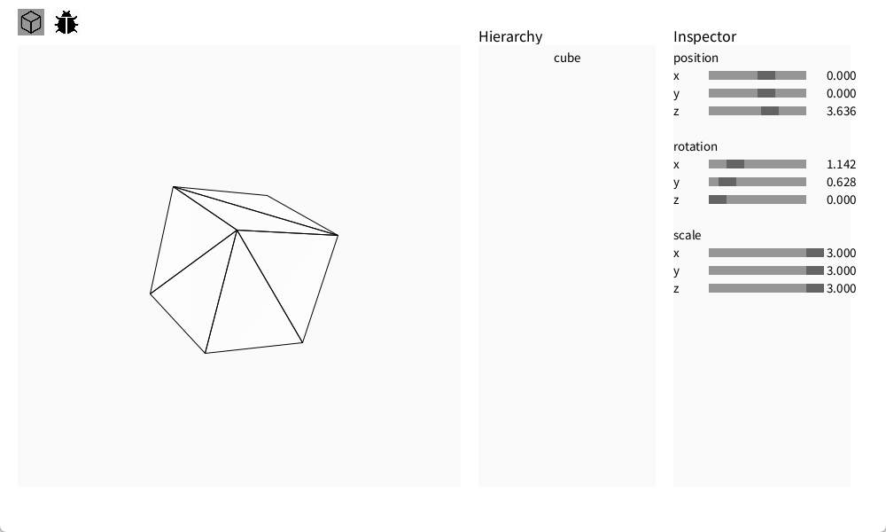

### 2. Position — Translation

I changed Position X and Y to check that the cube moved on the screen while keeping the Rotation and Scale settings unchanged.

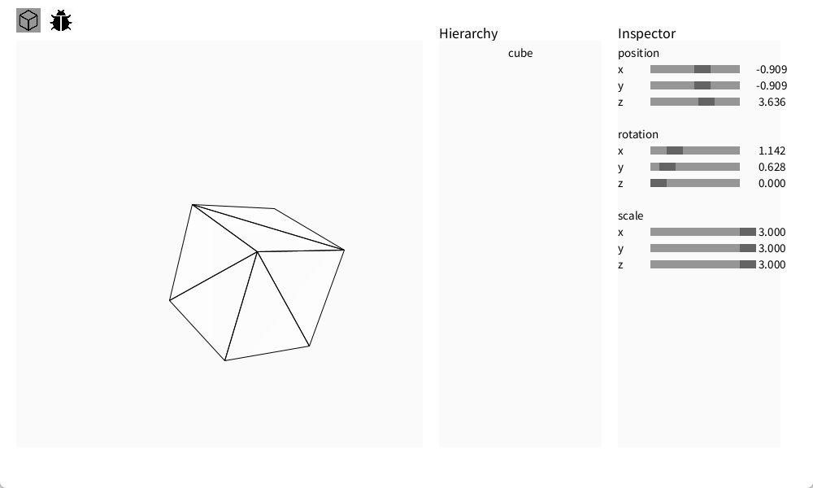

### 3. Position Z — Perspective Effect

I kept the cube's Rotation and Scale unchanged and increased Position Z. The cube appeared smaller as it moved farther from the camera, matching the expected perspective effect.

| Closer to the camera | Farther from the camera |
| --- | --- |
|  | 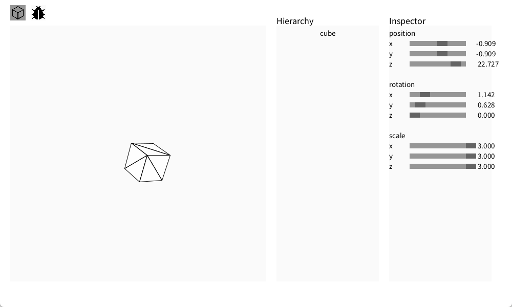 |

### 4. Rotation and Scaling

I adjusted the rotations around the three axes and the Scale values to observe changes in the model's orientation and size.

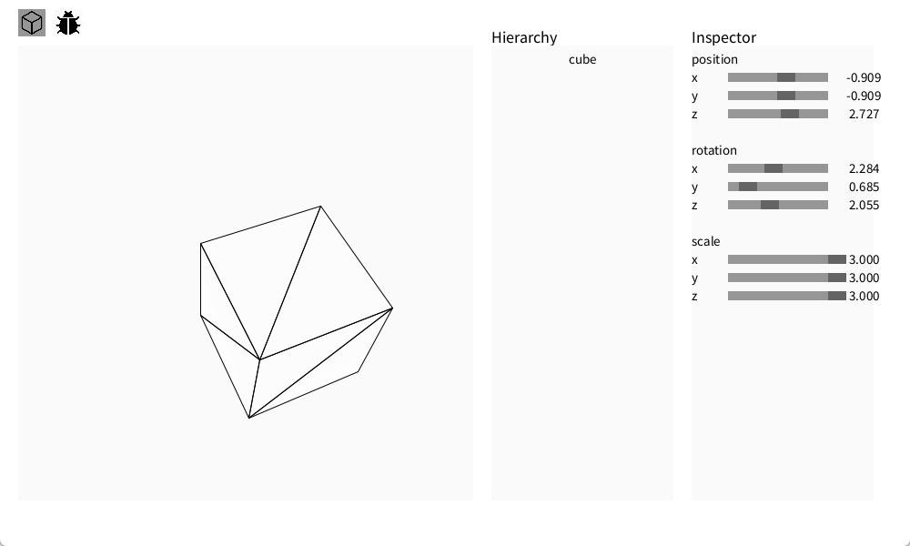

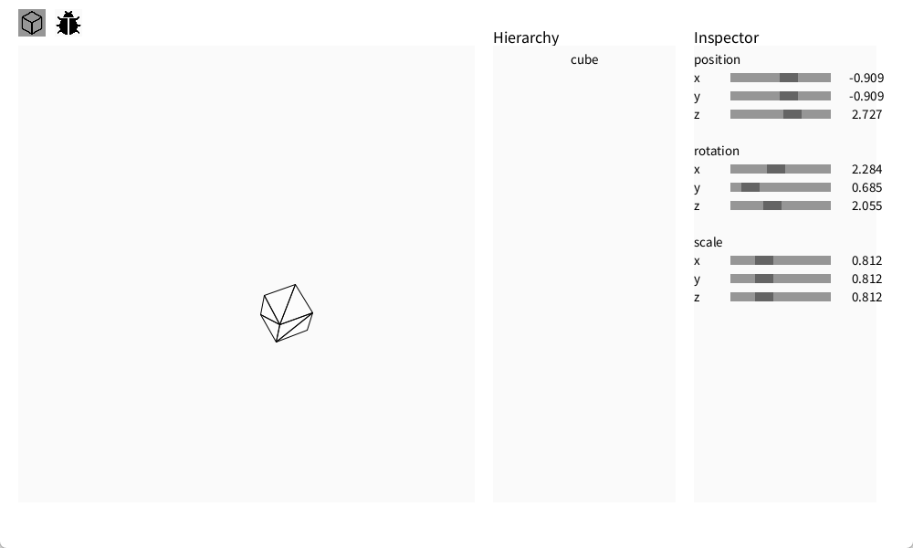

### 5. Bunny Model and Grayscale Depth

Besides the cube, I loaded `bunny.obj` to test a more complex model. Since the original Depth Shader output was close to white, I temporarily changed the background to gray so that the filled outline of the model was easier to see.

| Bunny at its initial angle | Bunny after rotation |
| --- | --- |
| 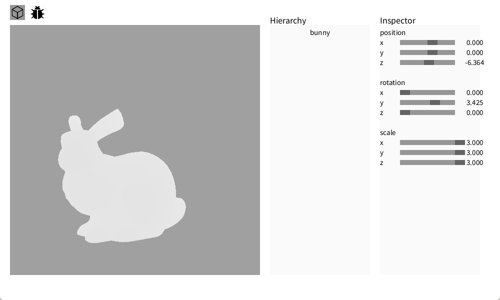 | 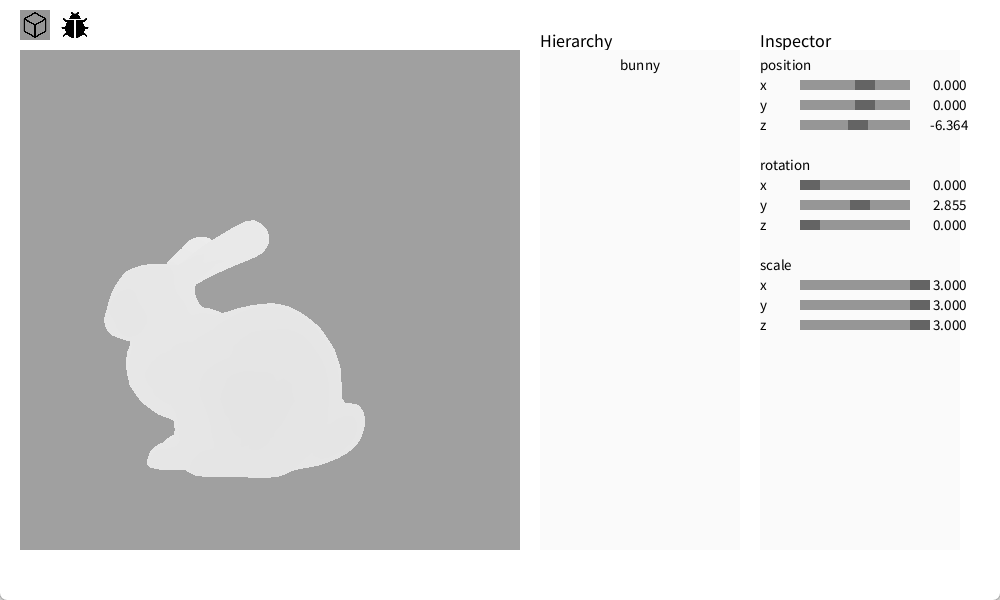 |

### 6. Depth Buffer — Overlapping Cubes

I loaded two cubes and applied different transforms so that they overlapped on the screen. The grayscale result showed which surfaces were in front of others. This was a visual test; I did not separately verify whether reversing the drawing order would produce exactly the same result.

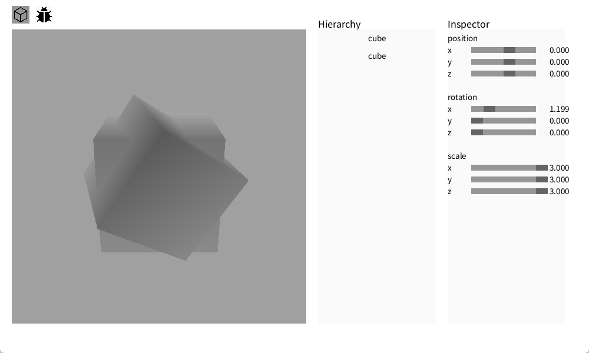

### 7. Backface Culling — ON / OFF Comparison

With the same Position, Rotation, and Scale settings, I compared the wireframe in Debug Mode with Backface Culling enabled and disabled. With culling enabled, triangles facing away from the camera were skipped, reducing the number of visible lines.

| Backface Culling OFF | Backface Culling ON |
| --- | --- |
| 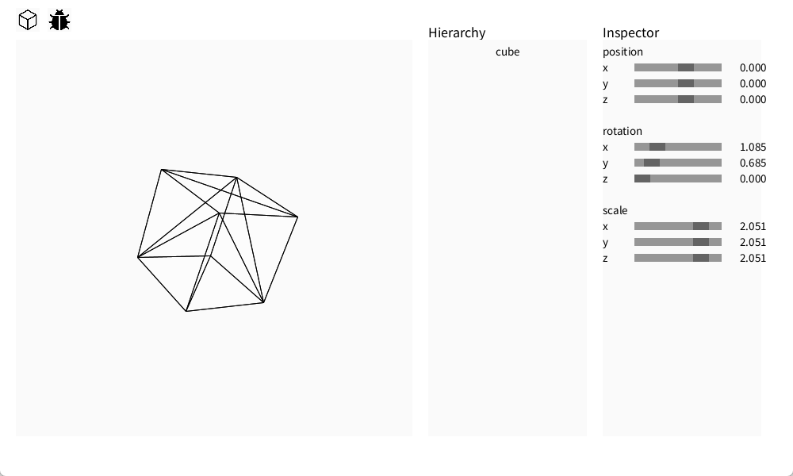 | 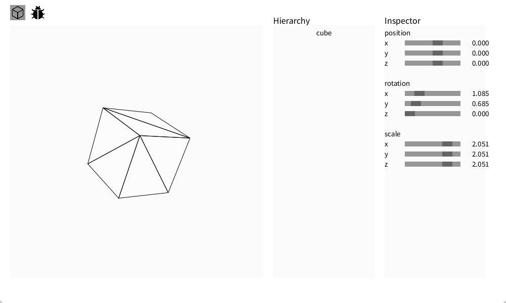 |

### 8. Camera Control — Moving the Camera

I kept the cube's Inspector values unchanged and moved the camera using the keyboard. The cube appeared at different sizes on the screen, showing that the change came from the camera position rather than the cube's Transform.

| Camera closer | Camera farther away |
| --- | --- |
| 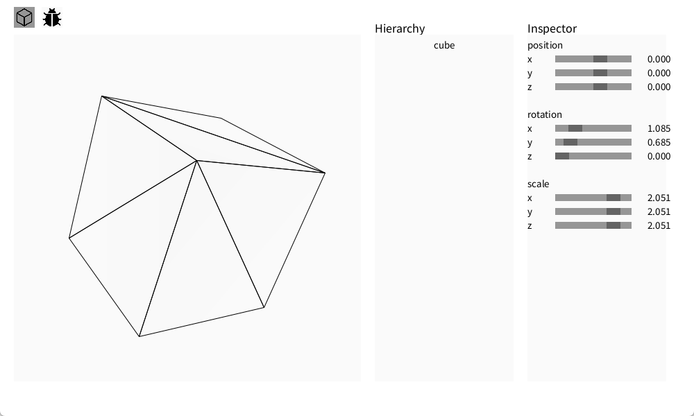 |  |

### 9. BONUS — 3D Clipping Boundary Tests

I moved the cube toward the visible boundaries and checked that the lines were cut off at the Canvas edges instead of extending into the Hierarchy or Inspector area.

**Right boundary:**

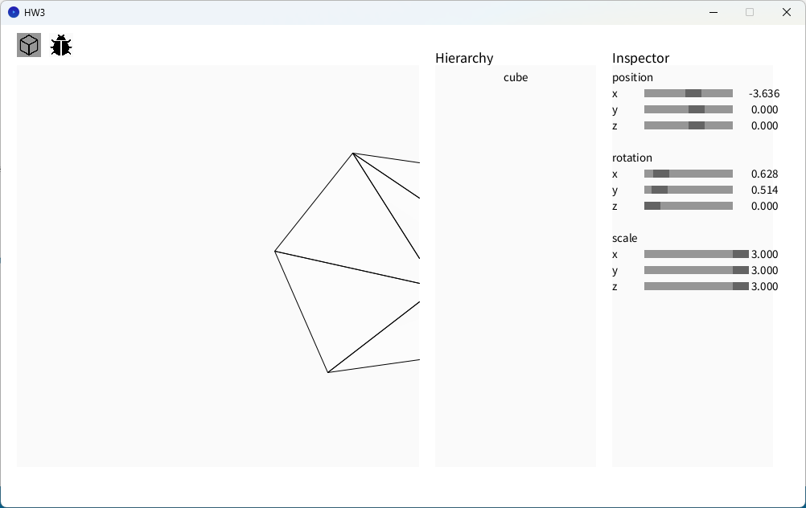

**Top and right boundaries:**

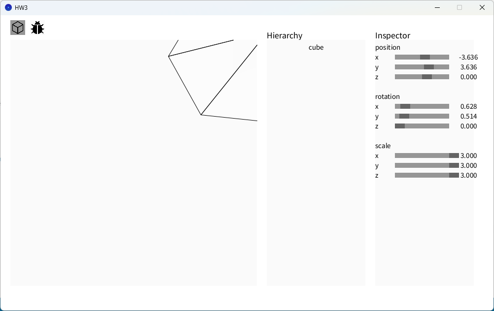

**Top and left boundaries:**

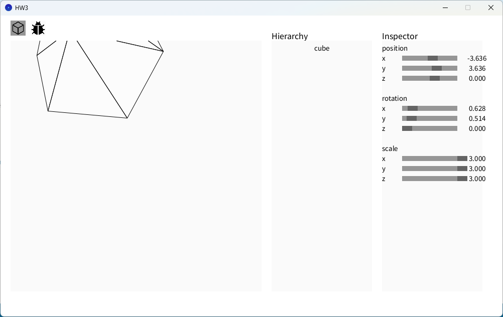

**Model completely outside the visible region:**

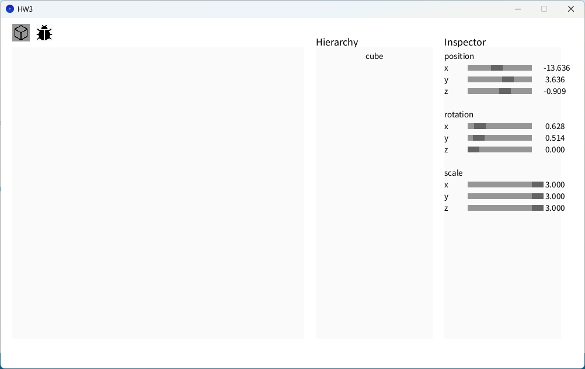

### 10. BONUS — Demonstration Video

I moved the camera to observe how the cube's wireframe appeared and disappeared as it approached, left, and re-entered the visible region. The video shows the behavior during use, but it does not by itself verify the exact mathematical boundaries of the Near and Far planes.

[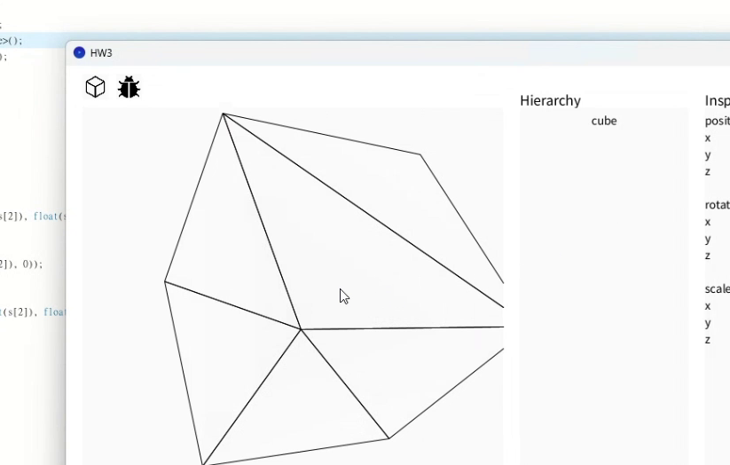](videos/bonus_clipping_demo.mp4)

**[▶ Watch the BONUS demonstration video (MP4)](videos/bonus_clipping_demo.mp4)**

> On GitHub, click the preview image or the link to open the video. If you download the complete project package, you can also play `videos/bonus_clipping_demo.mp4` directly.

## 6. References

- Lecture notes: 3D Transformation, Viewing Transformation, Perspective Projection, 3D Clipping, and Normal Vector
- [Computer Graphics Lab 3 assignment instructions](https://hackmd.io/@lab31718/CGlab3)
- Processing Lab 3 template provided by the professor
