# Computer Graphics Lab 3

## 一、作業內容

這次作業延續前兩次 Lab，使用 Processing 提供的程式架構，將原本的 2D 圖形處理擴充到 3D 模型。主要實作 Model、View、Projection Matrix，並加入 Depth Buffer、Backface Culling 和 Camera Control，讓模型可以進行座標變換、透視投影，以及前後遮擋的判斷。

另外也嘗試完成 **BONUS — 3D Clipping**，在 Debug 線框繪製前，將超出可視範圍的線段裁切掉。

### 已實作功能

- Rotation Matrix：X、Y、Z 軸旋轉（`makeRotX()`、`makeRotY()`、`makeRotZ()`）
- Translation / Scaling Matrix：平移與縮放（`makeTrans()`、`makeScale()`）
- Model Matrix：將 Local Space 頂點轉換成 World Space（`localToWorld()`）
- View Matrix：依照相機位置與觀看目標建立 Eye Matrix（`setPositionOrientation()`）
- Perspective Projection：將 3D 座標投影到可視範圍（`setSize()`）
- Depth Buffer：計算三角形內部像素的深度（`getDepth()`）
- Backface Culling：在 Debug Mode 跳過背對相機的三角形（`debugDraw()`）
- Camera Control：使用 `W`、`A`、`S`、`D`、`Q`、`E` 控制相機平移（`cameraControl()`）
- BONUS — 3D Clipping：針對 Debug 線框做六個平面的齊次座標裁切

## 二、實作方式

### 1. Rotation Matrix — X、Y、Z 軸旋轉

Lab 2 已經實作 Z 軸旋轉，這次延伸到 X、Y 軸。先使用 `makeIdentity()` 建立單位矩陣，再利用 `cos(a)` 和 `sin(a)` 設定對應位置。繞某個軸旋轉時，該軸的座標保持不變，其餘兩軸則會依照角度改變。旋轉角度使用弧度（radian）。

### 2. Model Matrix — Local to World

在 `GameObject.localToWorld()` 中，利用物體的 `position`、`rotation`、`scale` 組合矩陣：

```text
M = T × Ry × Rx × Rz × S
```

因為矩陣乘法作用在右側頂點上，所以實際變換順序為先縮放、再依序繞 Z、X、Y 軸旋轉，最後平移。這個順序是依照 Template 中 `worldToLocal()` 的反向關係組合，不是任意交換的。

### 3. View Matrix — Eye Matrix

在 `Camera.setPositionOrientation()` 中，先使用 `lookat - pos` 得到觀看方向 `V3`，再以 `top = (0,1,0)` 為上方參考方向，透過 Cross Product 計算 `V1` 和 `V2`，形成相機的三個互相垂直的座標軸。

接著將三個向量放入 GRM（General Rotation Matrix），再結合 Translation 和 Template 提供的 Mirror Matrix：

```text
View = Mirror × GRM × T(-cameraPosition)
```

這樣可以將 World Space 座標轉換成以相機為基準的 Eye Space。若觀看方向與 `top` 幾乎平行，則改用另一個上方參考向量，避免外積得到零向量。

### 4. Perspective Projection — 透視投影

在 `Camera.setSize()` 中，依照視角（FOV）、畫面寬高比（Aspect Ratio），以及 Near / Far Plane 建立 Projection Matrix。投影後先保留齊次座標，再透過 Perspective Divide 將 X、Y、Z 除以 W，產生近大遠小的效果。

這次採用的可視範圍為 X、Y 在 `-1～1`，深度 Z 在 `0～1`。Near / Far 的深度對應也會提供後續 Depth Test 使用。

### 5. Depth Buffer — 深度計算與遮擋

在 `util.getDepth()` 中，先使用三角形三個頂點 A、B、C 算出兩條邊，再透過 Cross Product 得到法向量 N：

```text
N = (B - A) × (C - A)
```

由平面方程式推得目前像素 `(x,y)` 的深度：

```text
z = Az - [Nx(x - Ax) + Ny(y - Ay)] / Nz
```

接著使用 Template 已有的 `GH_DEPTH` 和深度比較流程，只保留目前像素位置較靠近相機的表面。測試時使用兩個 Cube 重疊，觀察前後遮擋與深度灰階變化。

### 6. Backface Culling — 背面剔除

在 `GameObject.debugDraw()` 中，先將三角形頂點轉換到 Eye Space，計算法向量 `N`，再取得三角形指向相機的向量 `toCamera`。

```java
if (Vector3.dot(N, toCamera) <= 0) {
    continue;
}
```

當內積小於等於零時，跳過目前三角形的線框繪製。這樣可以減少背面的線條，但不等於對 Debug 線框做完整的隱藏線消除；不同正面之間仍可能有線條重疊。

### 7. Camera Control — 鍵盤控制相機

使用 `keyPressed()` 和 `keyReleased()` 記錄按鍵狀態，並在 `cameraControl()` 中更新相機位置。按鍵設定為：

| 按鍵 | 功能 |
| --- | --- |
| `W` / `S` | 前進 / 後退 |
| `A` / `D` | 左移 / 右移 |
| `Q` / `E` | 上移 / 下移 |

為了讓相機平移時維持原本的觀看方向，移動時會同步更新 `cam_position` 和 `lookat`。另外對移動向量使用 `normalize()`，避免同時按兩個方向時速度變快。

## 三、BONUS — 3D Clipping

這次 BONUS 主要參考課堂筆記中的 3D Clipping 原理，並沿用 Lab 2 裁切時 Inside／Outside 和線段交點的觀念。與 2D Clipping 不同的是，這次要在 **Perspective Divide 之前**處理四維的 Clip Space 座標 `(x,y,z,w)`。

### 1. 六個裁切平面

依照目前使用的投影座標範圍，建立六個判斷條件：

| 平面 | Inside 條件 |
| --- | --- |
| Left | `w + x >= 0` |
| Right | `w - x >= 0` |
| Bottom | `w + y >= 0` |
| Top | `w - y >= 0` |
| Near | `z >= 0` |
| Far | `w - z >= 0` |

使用 `clipValue()` 計算端點相對於每個裁切平面的位置。若兩端都在同一平面的外側，整條線段不保留；若線段跨越平面，就計算交點。

### 2. 線段交點與參數範圍

對線段 A、B，使用參數 `t` 表示線段上的位置：

```text
P(t) = A + t(B - A)
t = cA / (cA - cB)
```

其中 `cA`、`cB` 是兩端點代入同一裁切平面條件後得到的值。`lerpClip()` 會對 x、y、z、w 四個分量一起插值，避免在裁切前遺失 W 資訊。

在 `clipLine()` 中，用 `tEnter`、`tExit` 記錄目前仍可保留的線段區間，依序檢查六個平面。最後才對裁切後的兩端點進行 Perspective Divide，轉成螢幕座標後畫線。

### 3. 與 Debug 繪製整合

在 `debugDraw()` 中保留原本的 Backface Culling，將三角形三條邊各自轉成 Clip Space，再交給 `clipLine()` 判斷是否繪製。實際操作時，觀察到模型移出左右、上下邊界後，線框會停在 Canvas 範圍內；模型完全移出視野時，也不再顯示線框。

**目前 BONUS 的範圍是 Debug 線框的裁切**，沒有額外對 `Draw()` 的填色三角形進行完整的 Polygon Clipping。因此接近相機時，填色結果仍可能與線框不同；Near / Far Plane 也尚未個別完成嚴格的數值測試。

## 四、實作過程與 AI 使用說明

這次主要先參考課堂筆記和教授提供的 Processing Template，理解 3D 座標轉換、View Matrix、Perspective Projection、法向量與平面方程式的原理，再依照程式原本的架構補上需要的功能。

一開始對 GRM、`top`、`normalize()`、Perspective Divide 等觀念比較不熟悉，因此有請 ChatGPT 用實際座標和矩陣乘法逐步解釋，再對照講義理解每個步驟。程式實作時也參考了 ChatGPT 提供的範例，將 Model、View、Projection Matrix、Depth Buffer、Backface Culling 和 Camera Control 整合進專案。

BONUS 的六平面裁切部分，主要參考 ChatGPT 提供的 `clipValue()`、`lerpClip()` 和 `clipLine()` 實作方式，再搭配講義的交點公式理解流程，並使用 Cube 移動到 Canvas 邊界、完全離開畫面，以及移動相機的方式觀察裁切效果。

測試過程中曾發現關閉 Debug Mode 後，模型幾乎看不見。後來確認是深度灰階接近白色背景，因此暫時把 Render Buffer 背景調成灰色，讓填色結果比較容易辨認。另外也比較了 Backface Culling 啟用前後的線框差異，並請 ChatGPT 協助檢查截圖、整理測試結果及 README。

## 五、執行結果

### 1. 模型載入與基本顯示

載入 `cube.obj`，確認 Hierarchy 可以顯示模型，並在 Inspector 調整 Transform。

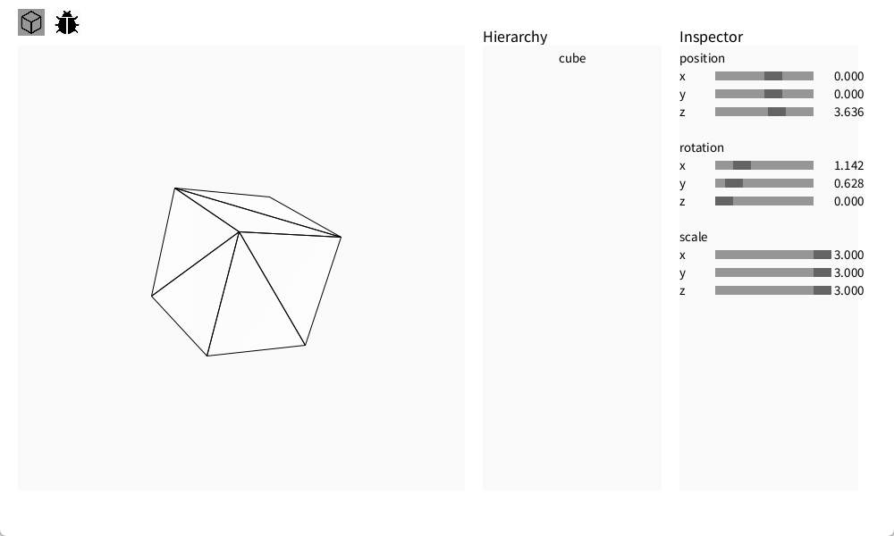

### 2. Position — 平移

調整 Position X、Y，確認 Cube 在畫面中的位置隨之改變，其他 Rotation 和 Scale 設定保持不變。


### 3. Position Z — 透視效果

保持 Cube 的 Rotation、Scale 相同，增加 Position Z 後，模型看起來變小，符合透視投影近大遠小的效果。

| 較靠近相機 | 較遠離相機 |
| --- | --- |
| 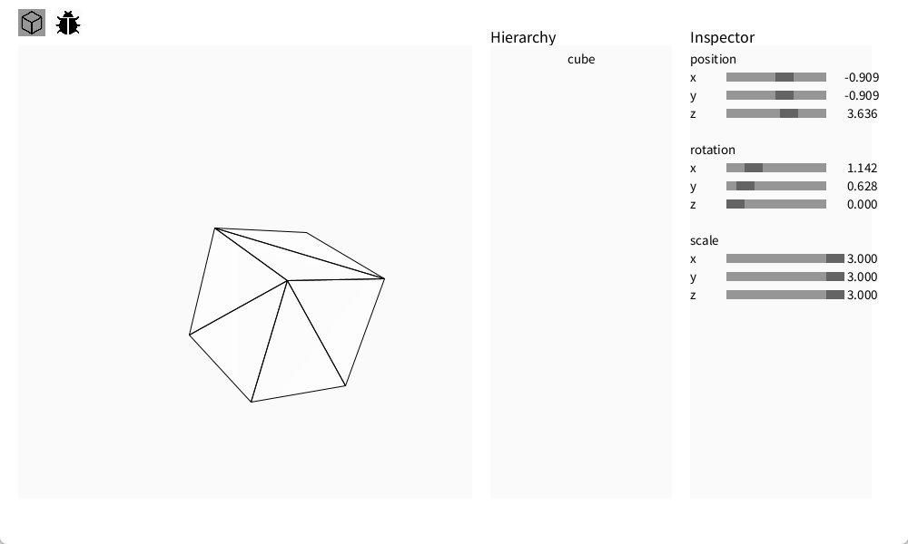 | 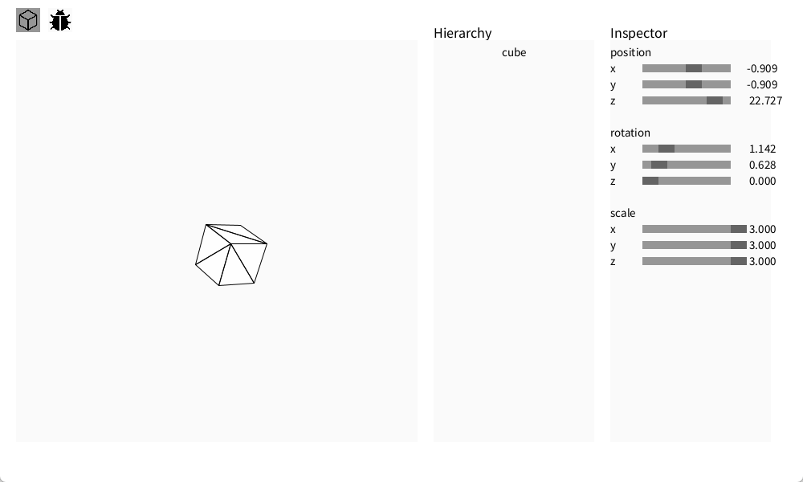 |

### 4. Rotation 與 Scaling

分別調整三軸 Rotation、Scale，觀察模型的方向與大小變化。

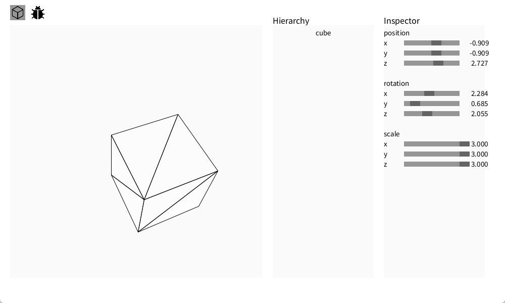

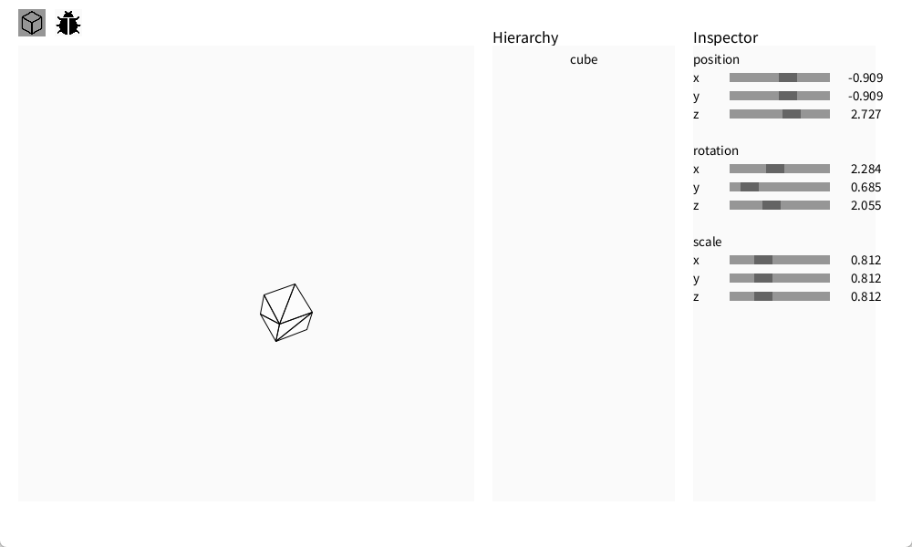

### 5. Bunny 模型與深度灰階

除了 Cube，也載入 `bunny.obj` 觀察較複雜的模型。由於原先的 Depth Shader 輸出接近白色，將背景暫時調成灰色後，能更清楚看見模型的填色輪廓。

| Bunny 初始角度 | Bunny 旋轉後 |
| --- | --- |
| 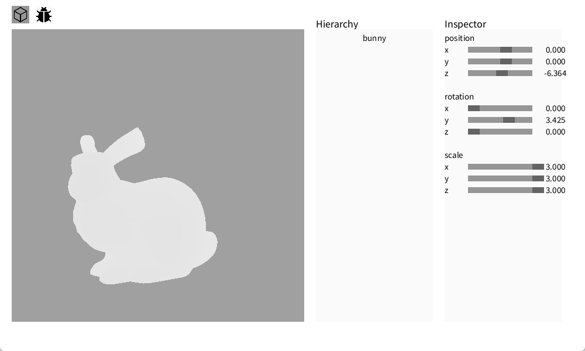 | 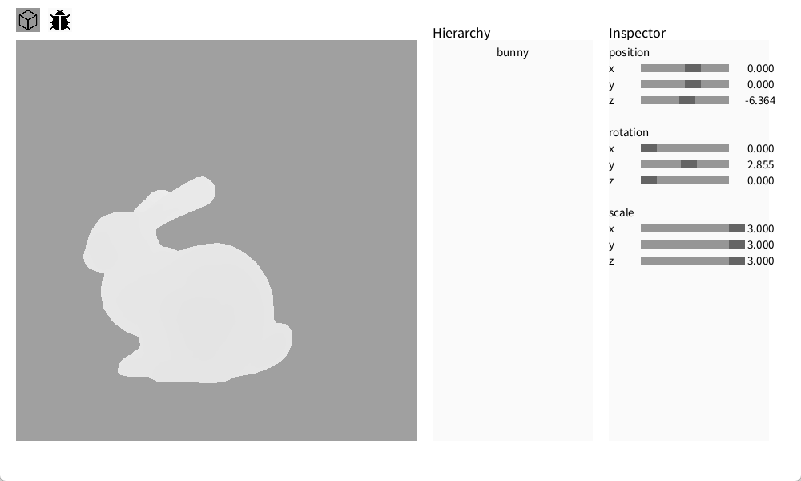 |

### 6. Depth Buffer — 重疊測試

載入兩個 Cube，設定不同的變換，使它們在畫面上重疊。從灰階結果可以觀察到前後表面的遮擋效果。這裡是視覺測試，尚未另外驗證交換物體繪製順序後是否完全一致。

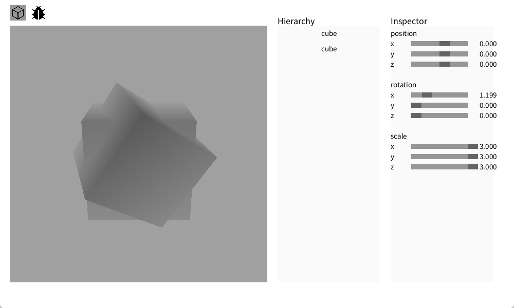

### 7. Backface Culling — 啟用前後比較

使用相同的 Position、Rotation 和 Scale，在 Debug Mode 下比較啟用前後的線框結果。開啟 Backface Culling 後，背對相機的三角形不再繪製，線條明顯減少。

| 關閉 Backface Culling | 開啟 Backface Culling |
| --- | --- |
| 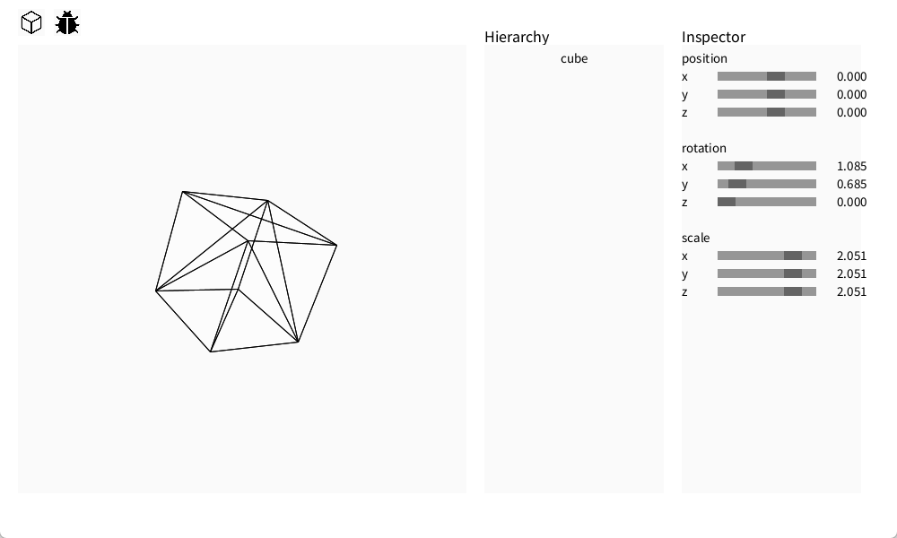 |  |

### 8. Camera Control — 移動相機

保持 Cube 的 Inspector 數值相同，透過鍵盤移動相機，觀察到模型在畫面中的大小改變，表示變化來自相機位置而非 Cube 本身的 Transform。

| 相機較靠近 | 相機較遠離 |
| --- | --- |
| 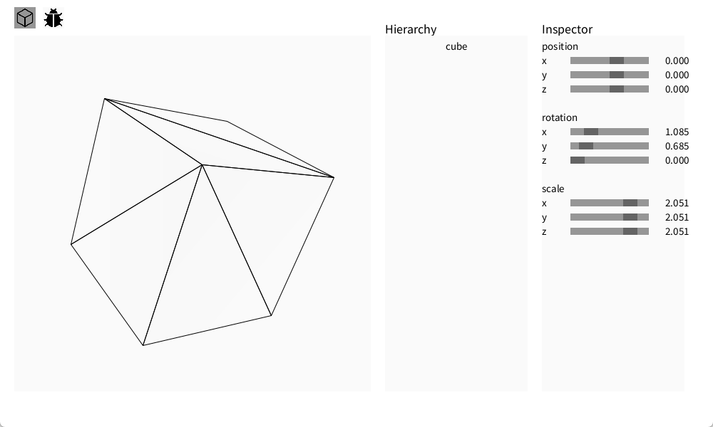 | 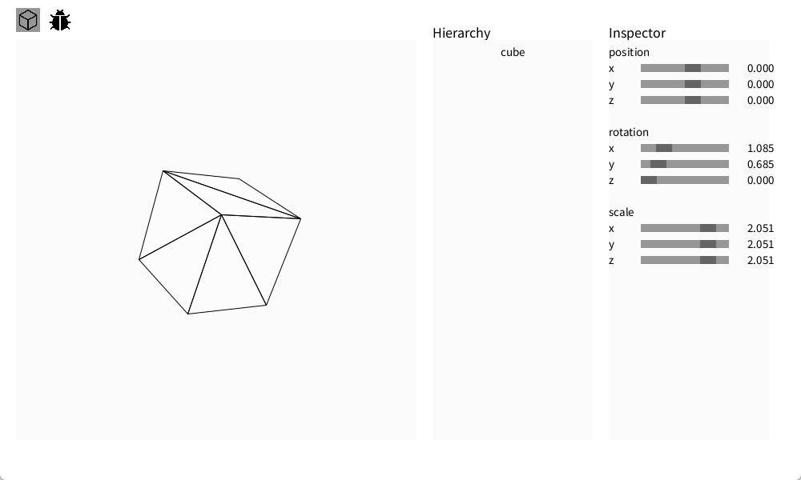 |

### 9. BONUS — 3D Clipping 邊界測試

將 Cube 移動到可視區域的邊界附近，觀察部分線段在 Canvas 邊緣被截斷，沒有繼續畫到右側的 Hierarchy / Inspector 區域。

**右側裁切：**

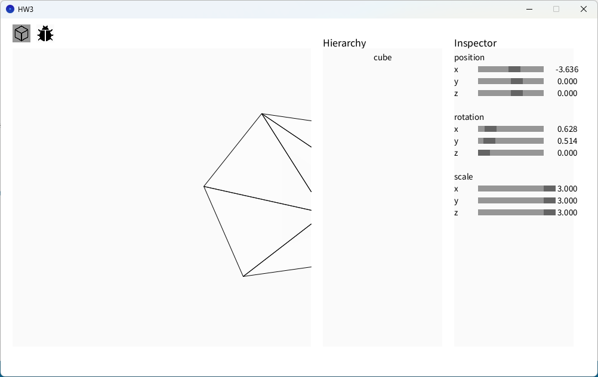

**上方與右側裁切：**

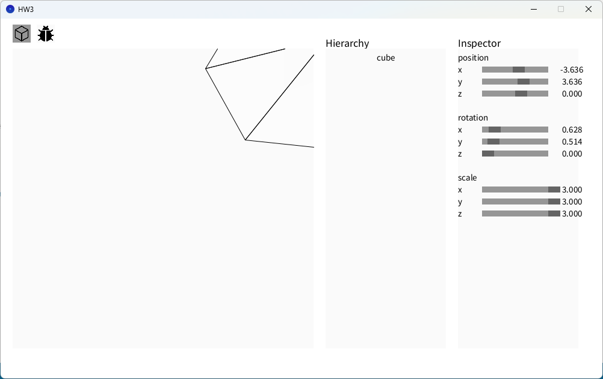

**上方與左側裁切：**

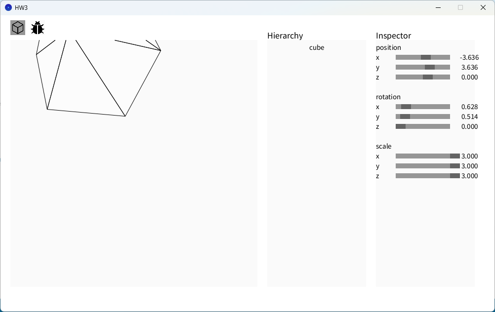

**模型完全移出可見區域：**

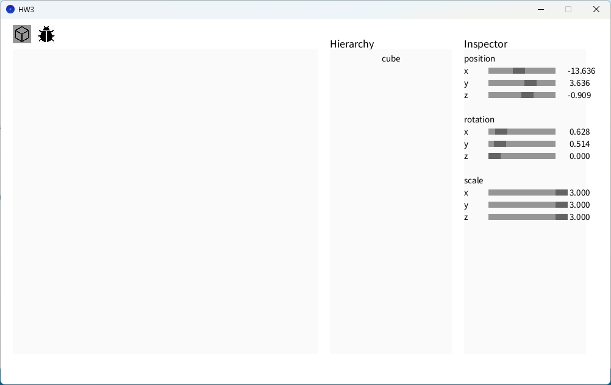

### 10. BONUS — 動態操作錄影

透過相機移動，觀察 Cube 在接近、超出及重新進入可視範圍時，線框如何顯示與消失。這段錄影作為操作展示，不單獨宣稱已完整驗證 Near / Far Plane 的數學邊界。

[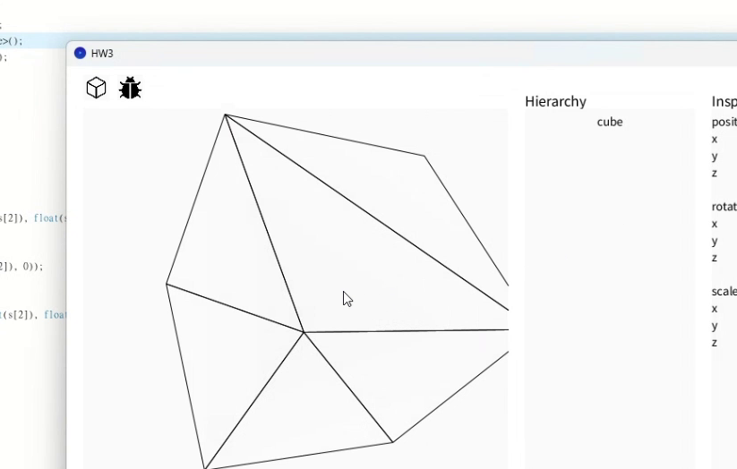](videos/bonus_clipping_demo.mp4)

**[▶ 點此觀看 BONUS 操作影片（MP4）](videos/bonus_clipping_demo.mp4)**

> GitHub 的 README 中，點選預覽圖或連結即可開啟影片；如果下載完整素材包，也能直接播放 `videos/bonus_clipping_demo.mp4`。

## 六、參考資料

- 課堂筆記：3D Transformation、Viewing Transformation、Perspective Projection、3D Clipping、Normal Vector
- [Computer Graphics Lab 3 作業說明](https://hackmd.io/@lab31718/CGlab3)
- 教授提供的 Processing Lab 3 Template
